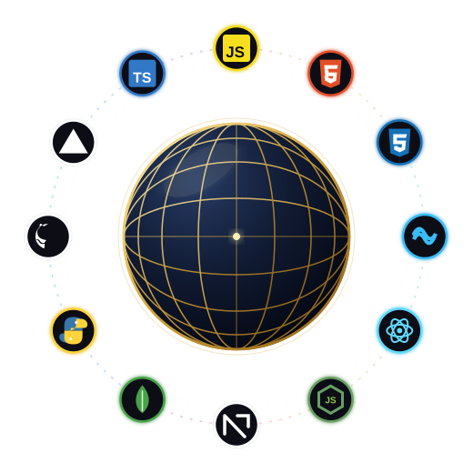

# GAMAGE RECRUITERS – TEAM 407

  
  &nbsp;&nbsp;
  

**Building Quality Software. Working as One Team.**

---

## About Team 407

Welcome to the official GitHub Organization of **Gamage Recruiters – Team 407**.

We are a collaborative software development team committed to building secure, scalable, reliable, and high-quality software solutions through teamwork, innovation, and professional engineering practices.

Our team focuses on continuous learning, technical excellence, creative problem-solving, and delivering meaningful software solutions.

## Our Vision

To become a professional, innovative, and reliable software development team that delivers quality technology solutions while continuously improving our technical and professional skills.

## Our Mission

- Build high-quality and maintainable software solutions.
- Follow professional software engineering practices.
- Encourage collaboration, knowledge sharing, and teamwork.
- Maintain secure and reliable development environments.
- Continuously learn and adapt to modern technologies.
- Deliver projects with responsibility and professionalism.

## Our Team Values

| Value | Description |
|---|---|
| **Teamwork** | Support each other and achieve goals together. |
| **Integrity** | Be honest, responsible, and transparent. |
| **Innovation** | Explore creative ideas and modern technologies. |
| **Quality** | Maintain high standards in every contribution. |
| **Security** | Protect source code, credentials, and organizational resources. |
| **Continuous Learning** | Improve technical and professional skills every day. |

## Our Technical Focus

We work with modern technologies and development practices across different areas of software engineering.

- **Frontend Development:** Building responsive and user-friendly interfaces.
- **Backend Development:** Developing secure APIs and business logic.
- **Database Management:** Designing and managing reliable data storage.
- **Full-Stack Development:** Integrating frontend and backend systems.
- **UI/UX Design:** Creating clean, accessible, and intuitive user experiences.
- **Software Engineering:** Applying clean code, testing, documentation, and maintainable architecture.

## Our Development Standards

- **Code Quality:** Write clean, readable, reusable, and maintainable code.
- **Git & GitHub:** Follow proper branching, meaningful commits, and Pull Request workflows.
- **Code Reviews:** Obtain approval before merging into protected branches.
- **Security First:** Never expose passwords, API keys, GitHub tokens, or confidential information.
- **Testing:** Test your changes before submitting contributions.
- **Documentation:** Maintain clear and updated project documentation.
- **Teamwork:** Communicate professionally and respect team members.
- **Professionalism:** Follow project guidelines, deadlines, and organizational policies.

## Development Workflow

1. Clone the latest project repository.
2. Pull the latest changes from the relevant development branch.
3. Create a separate feature or bug-fix branch.
4. Implement the assigned task.
5. Test your changes locally.
6. Commit using meaningful commit messages.
7. Push your branch to GitHub.
8. Create a Pull Request.
9. Resolve review comments and obtain approval.
10. Merge only after the required checks and approvals.

## Development Rules

1. Never push directly to protected branches such as `main`.
2. Create separate feature or bug-fix branches for assigned tasks.
3. Use meaningful commit messages.
4. Always pull the latest changes before starting development.
5. Create a Pull Request for code integration.
6. Resolve review comments before merging.
7. Never commit `.env` files, credentials, or suspicious files.
8. Scan downloaded files and scripts before execution.
9. Report security incidents immediately.
10. Never delete shared branches or modify others' work without authorization.

## Security & Responsibility

Every member is responsible for protecting organization repositories, source code, credentials, and development environments.

- Enable GitHub Two-Factor Authentication (2FA).
- Use tokens with minimum required permissions.
- Revoke compromised or exposed credentials immediately.
- Never share personal access tokens or passwords.
- Never execute unknown scripts or suspicious files.
- Follow approved security and malware prevention procedures.
- Keep development tools and dependencies updated.
- Access organization resources only for authorized purposes.
- Report suspicious activities or security incidents immediately.

## Collaboration & Communication

We believe strong communication creates strong teams.

- Share progress and updates with the team.
- Ask for help when facing technical challenges.
- Respect different ideas and opinions.
- Participate in code reviews and knowledge-sharing sessions.
- Support team members and collaborate to solve problems.
- Maintain professional communication across all team platforms.

## Our Commitment

We believe that great software comes from great teamwork, discipline, responsibility, and continuous learning.

Every contribution matters. Every improvement makes us stronger. Together, we aim to build software that reflects our commitment to quality and excellence.

**Code with Responsibility. Collaborate with Respect. Build with Excellence.**

---

  <b>GAMAGE RECRUITERS – TEAM 407</b> 
  <i>One Team. One Vision. Better Software.</i>

